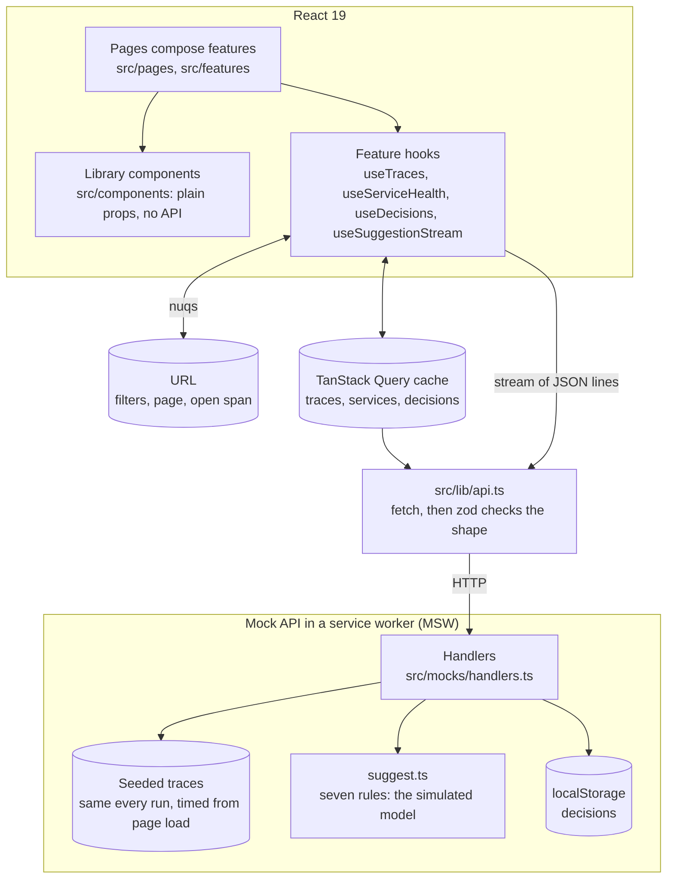

# Trace Investigator

A small React app for one person: **Maya, a backend engineer on call.** Something is slow or failing, and she has three questions.

1. **Which requests are slow or failing?**
2. **Where inside a request does the time go?**
3. **What do I tell the team?**

The app answers them in that order: find suspicious traces, look inside one, review an AI-suggested cause, and record the outcome. A Services page answers the first question from the other side: which service is in trouble.

**New to traces? Think of a parcel.** A _trace_ is the tracking history of one request, the way a parcel has a tracking history. Each _span_ is one stop on the way: a service that handled the request, or a query it ran. The app points at the stop where the parcel sat the longest, or where it was lost.

> **TODO before submitting:** replace `https://TODO.vercel.app` with the live address. It appears in the four link definitions at the very bottom of this file.

**Live:** [the app][live]

There is no backend. A mock API runs in the browser, with the same traces on every visit, timed back from the moment the page loads. Three traces are written by hand and are always the newest three in the list:

| Trace               | What it shows                                                        |
| ------------------- | -------------------------------------------------------------------- |
| [Slow query][slow]  | One query takes 78% of a 2.9 s request. The suggestion is confident. |
| [Error][error]      | A checkout that fails at the card acquirer call.                     |
| [Uncertain][unsure] | A slow request where no single step stands out. The AI says so.      |

## A two-minute tour

1. Open [the app][live]. The list shows the newest requests. Press **Error** in the status legend above the chart. The filters go into the address bar, so the list can be shared as a link. The chart is a scatter plot, one mark per request: the cloud of slow requests between 06:00 and 08:00 is when the database was overloaded. Drag across it to zoom in; the browser's Back button zooms out. Switch to **Volume** to see how many requests came in every half hour, failed ones in red. The sidebar on the left filters by request name, duration and time, and folds away. In the table, point at a trace ID to see all of it and copy it.
2. Open [the failed checkout][error]. Each row of the waterfall is one span, drawn where it ran. Click a row to see its details, or a caret to fold the spans below it.
3. Press **Suggest cause** beside the waterfall. The text arrives in pieces. When it is complete, follow the **Evidence** link to the span the claim is based on, then **Accept**, **Edit** or **Reject**. The decision is the record: it is still there after a reload, and the list marks the trace **Reviewed**.
4. Open **Services**. Pick **postgres**: how many calls it took, how many failed, how slow the slowest 5% were, and who called it. The slow hour shows as a hump in the duration lines. **Traces through postgres** opens the list filtered to it, and a service under **Dependencies** opens its own health.
5. In the header, **Simulate** switches the mock API to slow responses, server errors or no data, so every loading, error and empty state can be seen. Next to it is the theme toggle. **Design** shows every token and component in both themes.

## Run it

Requires Node 26 (see `.nvmrc`) and pnpm.

```sh
nvm use
pnpm install
pnpm dev                                  # http://localhost:5173
```

| Script        | What it does                                            |
| ------------- | ------------------------------------------------------- |
| `pnpm dev`    | Start the dev server                                    |
| `pnpm build`  | Typecheck and build for production                      |
| `pnpm check`  | Lint, format check, typecheck, unit and component tests |
| `pnpm e2e`    | Playwright tests against the production build           |
| `pnpm format` | Format with Prettier                                    |

Before the first `pnpm e2e`, install the browser: `pnpm exec playwright install chromium`.

## Architecture



**Data flow.** A component calls a feature hook and never calls `fetch`. The hook reads its inputs from the URL, asks TanStack Query, and Query calls `src/lib/api.ts`. Every response, and every line of the suggestion stream, is checked against a zod schema; the TypeScript types come from the schemas with `z.infer`. A response with the wrong shape ends in the same error state as a failed request.

**Pages compose features; features never import each other.** A page owns the layout and wires features together: the trace page puts the waterfall (traces) beside the suggestion panel (suggestion) and passes the evidence from one to the other. What every feature needs, the trace and span model, the known services and the time-bound URL parser, lives in `src/lib`. A decision is the outcome of reviewing a suggestion, so it lives in the suggestion feature. The trace page gives its workspace `key={trace.id}`, so another trace never inherits the previous one's suggestion; a test moves between two cached traces to prove it.

**The mock is a real HTTP boundary.** The app talks to `/api/...` and does not know the answers come from a service worker. Only two files outside the tests know the mock exists: `main.tsx`, which starts it, and the Simulate control (`SimulateControl`). No feature code would change for a real server.

```
src/
  app/              routes, layout, page heading, focus on navigation, Simulate control
  pages/            one folder per page; a page composes features and owns the layout
    traces/         filters, the chart section and the results section
    trace/          one trace: the waterfall beside the suggestion panel
    services/       one service's health
    design/         the /design page, one file per family of components (the only lazy route)
  features/         features never import each other
    traces/         list, filters, chart, waterfall, span details, self time
    services/       one service's health: filters, hooks, tiles, dependencies
    suggestion/     the stream, the review panel, and the stored decisions
  components/       library components. ui/ holds the styled primitives
  lib/              api client, formatters, small hooks, and what features share:
                    the trace model, known services, the time-bound URL parser
  mocks/            MSW handlers, seeded data, the seven rules, decision storage
  test/             test setup and helpers
e2e/                Playwright: smoke, happy path, accessibility
```

### Who owns which state

| State                                                    | Owner                                  |
| -------------------------------------------------------- | -------------------------------------- |
| Traces, services, decisions, and every write to them     | TanStack Query                         |
| Search, service, status, sort, page, duration, open span | The URL, through nuqs                  |
| The Services page's view, service and time range         | The URL, through nuqs                  |
| The life of a suggestion stream                          | `useReducer` (`suggestion/reducer.ts`) |
| The decision about a cause                               | The server                             |
| Theme                                                    | One hook (`useTheme`) and localStorage |
| The Simulate choice                                      | The mock layer                         |
| Text being typed, an open form                           | `useState`                             |

There is no global store. Server data has an owner, the URL has an owner, and the rest is local. The rule throughout is to store inputs and derive outputs: the reviewed marker on a row, the slowest span, the page count and the evidence to highlight are all computed while rendering, never stored.

### Where to look first

| File                                        | Why                                                             |
| ------------------------------------------- | --------------------------------------------------------------- |
| `src/features/traces/self-time.ts`          | The one piece of real logic: self time as a union of intervals  |
| `src/mocks/suggest.ts` and its test         | The seven rules, and one table-driven test for all of them      |
| `src/features/suggestion/reducer.ts`        | The stream as a small state machine                             |
| `src/features/suggestion/decision-hooks.ts` | Optimistic updates, rollback, and the two races that were fixed |
| `src/features/traces/filters.ts`            | URL state in one place, with one rule for returning to page 1   |
| `e2e/happy-path.spec.ts`                    | The whole story, by keyboard only                               |

## Decisions and their cost

**The mock API runs in production too.** The assignment has no backend, and a service worker gives the app a real HTTP boundary: real requests, real delays, real failures. _Cost:_ about 36% of the JavaScript is the mock layer, most of it cookie handling inside MSW that this app never uses (see [Bundle size](#bundle-size)).

**Filters live in the URL.** A filtered list is a link, and so is one open span. One function changes filters and it always clears the page, so no filter can forget to return to page 1. _Cost:_ changing a filter replaces the history entry, so Back leaves the list and does not undo filters one by one.

**Search is debounced on the request, not on the input.** The box updates the URL on every key, so it never lags and "Clear filters" just works. The request waits until typing stops for 300 ms.

**A page beyond the last shows the last page.** The API answers with the last page and the screen shows `min(page in the URL, last page)`. There is no effect that rewrites the URL and no second request. _Cost:_ the URL keeps the wrong number until the next click.

**The decision is optimistic.** A click on Accept, Save cause or Reject shows at once and is undone with a toast if the request fails; the suggestion is then back for review without asking the AI again.

**Saves of decisions go one at a time.** The mock answers after a random delay, so requests can arrive out of order, as on a real network. Tests caught two races: a slow save overwrote a later one, and a refetch hid a change that was still on its way. Now all saves share one queue, and the decisions are loaded again only when the last save finishes. _Cost:_ a change made in another tab shows only after a write or a reload.

**A service's requests are its calls, not the traces through it.** The Services page counts one request per span of the service, so a checkout that queries the database three times counts three times for postgres. That is what a service's load is. The link to the traces list says "Traces through postgres", not "these requests", because that list counts traces, and the two numbers differ. _Cost:_ a reviewer who expects them to match needs this sentence.

**The slowest 5%, not the average.** One 30-second call among a thousand fast ones barely moves an average, and that call is the one the on-call engineer is looking for. The tiles show the 95th percentile with the median beside it, and the duration chart draws both over time on the same log axis as the scatter plot, so 10 ms and 10 s are both readable. The percentile is the nearest rank, a value that really happened, not one made up between two. _Cost:_ a step with one call has that call as both its median and its slowest 5%.

**About 2% of requests fail, as in a healthy system.** Red is rare on the charts, so where it clusters means something: the hand-written checkout, a few failed payments. _Cost:_ the failure-related filters and rules have fewer examples to show; the three hand-written traces cover each case.

**Phone cards are two lines.** The request and its status, then how long it took, the service and when. The trace ID, the span count and the duration bar are on the trace's own page, so a phone shows about twice as many requests per screen. The charts are taller on a phone, where they are narrow. _Cost:_ a phone cannot copy a trace ID from the list.

**Span details open under the row, not in a side panel.** It works the same on a phone and keeps the details next to the bar they describe. _Cost:_ the rows below move down when one opens.

**The waterfall is a list of buttons, not an ARIA tree.** Each row is a plain button in the tab order, named with everything it shows: "postgres, SELECT orders WHERE user_id = ?, 2.26 s, OK, slowest span". The full tree pattern (arrow keys between rows, levels) is left out on purpose; folding is a separate caret button. Half of it would be worse than none.

**The slowest span is the one with the largest self time, not the longest.** The root span is always the longest, but it mostly waits. Self time subtracts the _union_ of the children's intervals, because two calls can run at once and a sum would count the overlap twice.

**Percentages round down.** 59.9% is shown as 59%, never as 60%, so the number on screen cannot contradict the rule that used it.

**Two charts for two questions.** The volume chart answers "how much traffic, and how much of it failed, when?": one bar per step of time, failed traces at the bottom in red. Clicking a bar or dragging across several sets the time range, so it is the quickest way to zoom in. The scatter plot answers "which requests were slow, and when?": one mark per trace, time along the bottom, duration up the side. A slow hour shows up as a cloud, which the volume chart cannot show, because it counts requests and does not time them. It is a switch, not two charts at once, kept in the URL (`?chart=scatter`). I decided against a third view, a heatmap: it is for millions of requests, and at 500 most of its cells would be empty. _Cost:_ a second endpoint and about 7 kB of code.

**The scatter plot draws on a log scale.** Most requests take 10 to 300 ms and a few take seconds. On a linear scale the fast ones would be a flat line at the bottom. Each power of ten (10 ms, 100 ms, 1 s, 10 s) gets the same height. The axis is fixed, so it does not jump when a filter changes. A trace outside it would be drawn at the edge; the demo data has none.

**The scatter plot is for the mouse; the table is for the keyboard.** 500 tab stops would be useless, so the marks are not in the tab order and the plot is hidden from screen readers. They hear a summary instead ("503 traces from … to …. 9 failed. The slowest took 3.62 s."). The table below lists the same traces, and every trace in it can be reached and opened by keyboard. A failed trace is a filled red mark and an OK one a smaller black dot. Red and black are too close in lightness (2.7:1 in the light theme, 2.0:1 in the dark) to tell apart by colour alone, so the red mark is also bigger and has a thin ring in the page colour, which also keeps it visible where it sits on black ones.

**The status filter is the chart's legend.** "OK" and "Error" sit above the chart as two buttons, in both the volume and the scatter view: pressing one shows only that status, pressing it again shows both. They look pressable on purpose: bordered pills that react to the pointer and a "Status" label in front. The one that is on is filled in the primary colour (black with white text in the light theme) with a ×, and its mark gets a ring so the red stays visible on black. The status that is filtered away is greyed out, mark and text, so the legend never shows a colour that is not on the plot. _Cost:_ status is no longer next to the other filters, and there is no way to pick "both" other than pressing the active one again.

**A filter sidebar with counts, beside the filter row.** Name is a checklist: each name with how many traces it gives ("POST /login 24"), so a dead end can be seen before it is clicked, and a search box above it that narrows the names as you type. Any number can be checked, and a trace matches any of them; nothing checked means every name. A name with no traces is disabled unless it is checked. Each filter's counts ignore that filter itself, so checking one name leaves the other names with their counts. A checked name stays checked while the search hides it, and "Clear (2)" beside the label says how many are on. The names are native checkboxes: Space and their state in a screen reader come free. A checked row is marked by its box and a grey background, not by bold text. The sidebar folds into a strip that shows how many of its filters are on, so a hidden filter is never forgotten; the choice is remembered. On narrow screens it is a closed "Filters" button above the list. _Cost:_ two places to filter: the row on top and the sidebar.

**Duration is two fields, a min and a max in milliseconds,** so any range can be asked for, such as "slower than 750 ms". Both ends are included, as a person reads "min 100, max 500". The fields are text fields that keep only digits, not `type="number"`, which reports an empty value while its text is half typed. A max below the min is pointed out under the field. The request waits until typing stops, as for search. _Cost:_ no counts beside the duration, and no one-click ranges.

**Time is a range picker, and a range is two bounds written as text.** A button says what is picked ("Last 6 hours") and opens a searchable list of quick ranges, which apply on one click, beside From and To fields, which apply with their button so a half-typed time is never sent. A bound is `now`, `now-6h` or `2026-11-14 06:00` in UTC, and the URL keeps it as written (`?from=now-6h&to=now`), so a shared link to "the last 6 hours" still means that tomorrow. The server turns relative bounds into times with its own clock; in the demo that is the moment the page loaded, so "Last hour" always has traces in it. A mistake is named under its field ("The end must come after the start.") and focus moves to it. _Cost:_ no calendar: picking a day means typing it, because a calendar would be a new dependency. Quick ranges have no counts.

**The app's own dropdowns, a combobox for services, Radix for the popover.** I write a thing myself when it is simple and use a library when the edge cases are the hard part. Sort is a short fixed list, so it is a `SelectMenu`: the same button and list as the service dropdown, without a search box, built on Radix's dropdown menu. Its choices are radio items, so a screen reader hears which one is checked, and arrow keys and typing a letter move through them. It is not modal and its list is not moved to the end of the page: a modal menu hid the whole page from screen readers, and a list outside the main landmark failed axe. The service list is the one that grows in a real system, so it adds a search box, with each service's icon in its colour; cmdk owns the filtering and the arrow keys there. Both share one look (`ui/picker.ts`). The Simulate control in the header uses the same `SelectMenu`, so there is no native select left. _Cost:_ two more dependencies than native selects would need (cmdk, 11 kB, and the Radix dropdown menu).

**The table sorts from its headers too.** Duration and Started are buttons with an arrow: down is slowest or newest first, up the other way round, and a double arrow says the column can be sorted but is not. A first click picks the order someone looking for trouble wants (slowest, newest), a second turns it around. `aria-sort` on the header tells a screen reader which way the column is sorted. The header and the Sort dropdown set the same `sort` in the URL, so they always agree, and the cards on a phone, which have no headers, still have the dropdown. Request, Status and Spans cannot be sorted, because the API cannot sort by them, so they have no arrow. _Cost:_ two ways to do one thing.

**No automatic retries.** A failed request shows the error and a Retry button straight away. A missing trace or a wrong response shape would not fix itself.

**Times are shown in UTC,** so the seeded data reads the same for every viewer.

## The suggested cause

**The model is simulated.** There is no AI behind the suggestion. Seven fixed rules in `src/mocks/suggest.ts`, checked in order, decide the text and the confidence. This keeps the interesting part honest and testable: how an interface should present a claim that might be wrong.

"Slow" means 1 s or more. It is one constant and an assumption: a real system would compare a request with the normal time for its operation.

| #   | When                                                   | Confidence | Basis shown                                       |
| --- | ------------------------------------------------------ | ---------- | ------------------------------------------------- |
| 1   | The request failed, and the failure began in one place | High       | "error reached the request"                       |
| 2   | The request failed, and failures began in several      | Medium     | "error reached the request, several spans failed" |
| 3   | Slow, and one span's self time is 60% or more          | High       | "78% of trace time"                               |
| 4   | Slow, and one span's self time is 30% to under 60%     | Medium     | "42% of trace time"                               |
| 5   | A span failed, but the request succeeded               | Medium     | "a span failed, the request succeeded"            |
| 6   | Slow, and none of the above                            | Low        | "largest span is 18% of trace time"               |
| 7   | Not slow, and nothing failed                           | None       | No claim is made                                  |

Exactly 60% is high and exactly 30% is medium. On equal self time the earlier span wins. One table-driven test covers every rule, both boundaries, the tie, and the order between rules.

**How the interface treats the claim**

- **A suggestion is never the conclusion by itself.** It sits in a dashed frame under "Suggested cause" until a person accepts it, edits it or rejects it. Only then is there a "Cause", labelled "Accepted by you" or "Edited by you".
- **The claim links to its source.** The spans it is based on are links in the panel and are marked "Evidence" in the waterfall. It is the same pattern as an AI-extracted value that links to its place in the source document.
- **The confidence shows its basis:** "High confidence. Based on: 78% of trace time". The badge is not coloured, because a green "high" would read as "correct".
- **The text says where, never why.** The data shows which span failed or was slow. It does not show the reason, so the suggestion does not guess one.
- **On low confidence, Edit is the primary button,** not Accept. When nothing looks wrong there is nothing to accept, so the only button is "Write a cause yourself".
- **The AI's confidence stays with the AI's text.** For an edited cause it is behind "View original AI text", because the user's own words were never rated.
- **Half a suggestion is never offered for a decision.** A stream that closes before its last line is an error.

**Where the rules are wrong**

- **Timeouts.** When a caller gives up on a slow child, the caller is the deepest failed span, so rule 1 names the caller. The real cause is the slow child, which never failed.
- **Many identical queries.** Twenty queries of 4% each add up to 80%, but no single span stands out, so rule 6 says so. Grouping spans by operation would catch it.

## Design system

- **Semantic tokens only.** Every colour is a token in `src/index.css`. Components use token names and contain no raw colours and no `dark:` variants, so a theme changes the tokens and never the components.
- **Colour has two jobs:** status and service identity. The rest of the interface is neutral.
- **Status is an icon plus text,** never colour alone.
- **Contrast is computed, not judged by eye.** Text tokens are at least 4.5:1 on every surface. Lines and bars that carry meaning are at least 3:1. The eight service colours were picked by a search that also keeps them apart for red-green colour blindness. The light set clears every target. The dark set is just under one of them (14.3 against 15 for normal vision), which is acceptable because every bar has its service name beside it as text.
- **Library components take plain props and know nothing about the API.** They are all on `/design`, in every state and both themes side by side.

## Accessibility

The target is WCAG 2.1 AA.

- Landmarks, a skip link, one `h1` per page, and a visible focus style.
- Focus moves to the heading when the page changes, and each page names the browser tab.
- The result count is announced when the list changes. The suggestion is announced once, when it is complete, not word by word.
- Form errors are tied to their fields with `aria-describedby`. Buttons that repeat on a page say what they act on ("Collapse orders list orders").
- Reduced motion is respected, in this app's styles and in the libraries'.
- Nothing scrolls sideways at 320 px.
- axe runs on 22 page states in both themes.

**What is not done.** I have not tested with a real screen reader, which is the main gap: axe checks rules, not whether a page makes sense read aloud. The end-to-end tests run in Chromium only.

## Testing

| Level               | Count | What it covers                                                                                                                             |
| ------------------- | ----- | ------------------------------------------------------------------------------------------------------------------------------------------ |
| Unit                | 175   | Span order, self time, the slowest span, duration ranges, chart scales, the seven rules, the stream reducer, the line splitter, formatters |
| Component, with MSW | 132   | Filters and the URL, every state of every page, optimistic updates and rollback, forms, the suggestion panel                               |
| End to end          | 90    | A keyboard-only happy path, axe on every page in both themes, reflow at 320 px, keyboard and reduced-motion checks                         |

Component tests render the whole app against the same mock handlers the browser uses, so they test behaviour through the real HTTP boundary and not internals. CI runs lint, format check, typecheck, the unit and component tests and the build, and the end-to-end tests as a second job.

## Libraries

| Library                               | Why                                                                                   |
| ------------------------------------- | ------------------------------------------------------------------------------------- |
| React 19, TypeScript 7 (strict), Vite | The current stable set. `noUncheckedIndexedAccess` forces a check on every `items[0]` |
| React Router                          | The data router, for the route error element and the lazy route. Not for loaders      |
| TanStack Query                        | Server state: caching, keeping the last rows while the next load, optimistic writes   |
| nuqs                                  | Typed URL state with parsers and defaults                                             |
| zod                                   | One schema per response, and the types come from it                                   |
| MSW                                   | The mock API as a real HTTP boundary, in the browser and in tests                     |
| Tailwind 4                            | Tokens as CSS variables and utilities that only use them                              |
| Radix, with shadcn's conventions      | Popover, dropdown menu and tooltip: focus management is the hard part                 |
| cmdk                                  | The service combobox: filtering as you type, arrow keys, Enter                        |
| lucide                                | Icons                                                                                 |
| class-variance-authority, cn          | Variants and class merging for the styled primitives                                  |
| Geist (variable font)                 | One typeface, loaded from the bundle, not from a third party                          |
| sonner                                | Toasts that are announced to screen readers                                           |
| Vitest, Testing Library               | Unit and component tests                                                              |
| Playwright, axe                       | End-to-end and accessibility tests against the production build                       |
| oxlint, Prettier                      | Lint (with the jsx-a11y rules) and formatting                                         |

**Left out on purpose:** a global store (Zustand), a state machine library (XState), a table library, a form library, a date library, a chart library (the scatter plot is plain SVG with percentage positions, so it fits any width without measuring it), and React's `useOptimistic` (TanStack Query owns the writes, and two owners of one optimistic update is one too many). The forms are small: the longest has two fields.

## Bundle size

|                        | JavaScript | Gzipped |
| ---------------------- | ---------- | ------- |
| With the lazy route    | 1,090 kB   | 370 kB  |
| The `/design` chunk    | 12 kB      | 3.5 kB  |
| Without the lazy route | 1,100 kB   | 372 kB  |

**Lazy loading saved little:** 10 kB, under 1% of the first load. Only one page is split, the one most visitors never open. Splitting the main flow would save more but adds complexity for no visible gain at this size.

**What the main file is made of** (minified, before gzip):

| Part                                                      | Size   | Share |
| --------------------------------------------------------- | ------ | ----- |
| The mock API: MSW and the cookie code it brings           | 380 kB | 35%   |
| React and React DOM                                       | 215 kB | 20%   |
| React Router                                              | 95 kB  | 9%    |
| zod                                                       | 86 kB  | 8%    |
| This app's own code                                       | 76 kB  | 7%    |
| Everything else (Query, nuqs, sonner, Radix, cmdk, icons) | 238 kB | 22%   |

The largest single item is a public suffix list (257 kB) that MSW uses for cookies, which this app never sets. With a real backend the mock layer would not ship at all.

## How AI tools were used

I used Claude Code for the whole build, in this way:

- **The plan came first.** A written spec was agreed before any code: the user, the screens, the state owners, the API, the rules for confidence, the stack and a build order of nine steps. Most decisions in this README were made there, not found in the code afterwards.
- **One step at a time.** Claude built each step and stopped. I reviewed the step and made every commit myself. Claude never committed or pushed.
- **What was delegated:** writing the code and the tests for each step.
- **What checked the work:** lint with accessibility rules, strict types, unit and component tests, and end-to-end tests with axe after every step, plus screenshots at several widths.

**Mistakes the checks caught.** These are the ones worth knowing about:

- **Rows dimmed while loading failed contrast.** The first version of the list dimmed the current rows while the next ones loaded. axe failed it: dimmed text falls below the contrast minimum. It now says "Updating…" instead.
- **A slow save could overwrite a later one.** An end-to-end test that passed most runs and failed now and then turned out to be a real race, not a flaky test: two saves made in quick succession could reach the server in the wrong order, and the older one won. The saves now share one queue.
- **Chart buttons had a spoken name that did not contain their visible text.** That fails WCAG 2.5.3, which matters to people who operate a page by voice.
- **A lookup returned a function for a service called `toString`.** A plain object was used as a map. It was noticed while writing the test for that case, and is now a `Map`.

## Original work

All application code and the visual design were written for this assignment. Nothing is taken from an employer's product or from any other product.

What is not mine: the libraries listed above, the `Button` component generated by shadcn (edited to use tokens only), the Geist font, the lucide icons, and `public/mockServiceWorker.js`, which MSW generates. The random number generator in the seed is mulberry32, a small public-domain algorithm.

## What I would refactor

- **Rollback restores a snapshot.** With two optimistic changes in flight, undoing the first briefly hides the second. Rendering pending changes from the mutations themselves would be more exact.

## What is next, and how it scales

- **A real backend and a real model.** The HTTP boundary and the schemas are already there. The interface around the claim does not change.
- **Generated API types.** The zod schemas are written by hand. With a real API they should come from its OpenAPI description.
- **Grouping spans by operation,** to catch the "many identical queries" case.
- **Virtualised lists.** The list is paged at 25 and traces are capped at about 30 spans. Real traces have thousands of spans, and the waterfall would need virtualisation.
- **The full ARIA tree pattern** for the waterfall, now that its rows fold.
- **A global store,** when real cross-page client state appears. Today there is none.
- **Storybook** in place of `/design`, once more than one person works on the components.
- **Span attributes** (query text, error message), so the details panel can show more than timing.
- **Smaller things:** decisions that stay fresh across tabs, tests in Firefox and Safari.

[live]: https://TODO.vercel.app
[slow]: https://TODO.vercel.app/traces/a1b2c3d4e5f60001
[error]: https://TODO.vercel.app/traces/a1b2c3d4e5f60002
[unsure]: https://TODO.vercel.app/traces/a1b2c3d4e5f60003
