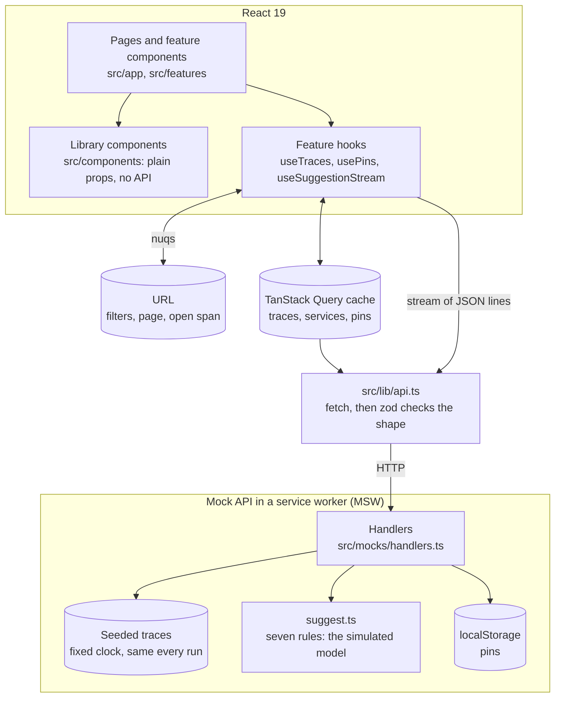

# Trace Investigator

A small React app for one person: **Maya, a backend engineer on call.** Something is slow or failing, and she has three questions.

1. **Which requests are slow or failing?**
2. **Where inside a request does the time go?**
3. **What do I tell the team?**

The app answers them in that order: find suspicious traces, look inside one, review an AI-suggested cause, and record the outcome.

**New to traces? Think of a parcel.** A _trace_ is the tracking history of one request, the way a parcel has a tracking history. Each _span_ is one stop on the way: a service that handled the request, or a query it ran. The app points at the stop where the parcel sat the longest, or where it was lost.

> **TODO before submitting:** replace `https://TODO.vercel.app` with the live address. It appears in the four link definitions at the very bottom of this file.

**Live:** [the app][live]

There is no backend. A mock API runs in the browser, with the same data on every visit. Three traces are written by hand and are always the newest three in the list:

| Trace               | What it shows                                                        |
| ------------------- | -------------------------------------------------------------------- |
| [Slow query][slow]  | One query takes 78% of a 2.9 s request. The suggestion is confident. |
| [Error][error]      | A checkout that fails at the card acquirer call.                     |
| [Uncertain][unsure] | A slow request where no single step stands out. The AI says so.      |

## A two-minute tour

1. Open [the app][live]. The list shows the newest requests. Set **Status** to Error, or click a bar of the duration chart. The filters go into the address bar, so the list can be shared as a link.
2. Open [the failed checkout][error]. Each row of the waterfall is one span, drawn where it ran. Click a row to see its details.
3. Press **Pin trace**, then **Suggest cause**. The text arrives in pieces. When it is complete, follow the **Evidence** link to the span the claim is based on, then **Accept**, **Edit** or **Reject**.
4. Open **Investigation**. Write a note, save it, and mark the trace as resolved.
5. In the header, **Demo** switches the mock API to slow responses, server errors or no data, so every loading, error and empty state can be seen. Next to it is the theme toggle. **Design** shows every token and component in both themes.

## Run it

Requires Node 26 (see `.nvmrc`) and pnpm.

```sh
nvm use
pnpm install
pnpm dev                                  # http://localhost:5173
```

| Script        | What it does                                            |
| ------------- | ------------------------------------------------------- |
| `pnpm dev`    | Start the dev server                                    |
| `pnpm build`  | Typecheck and build for production                      |
| `pnpm check`  | Lint, format check, typecheck, unit and component tests |
| `pnpm e2e`    | Playwright tests against the production build           |
| `pnpm format` | Format with Prettier                                    |

Before the first `pnpm e2e`, install the browser: `pnpm exec playwright install chromium`.

## Architecture



**Data flow.** A component calls a feature hook and never calls `fetch`. The hook reads its inputs from the URL, asks TanStack Query, and Query calls `src/lib/api.ts`. Every response, and every line of the suggestion stream, is checked against a zod schema; the TypeScript types come from the schemas with `z.infer`. A response with the wrong shape ends in the same error state as a failed request.

**The mock is a real HTTP boundary.** The app talks to `/api/...` and does not know the answers come from a service worker. Only two files outside the tests know the mock exists: `main.tsx`, which starts it, and the Demo control. No feature code would change for a real server.

```
src/
  app/              routes, layout, page heading, focus on navigation, Demo control
  components/       library components. ui/ holds the styled primitives
  features/
    traces/         list, filters, chart, waterfall, span details, self time
    investigation/  pins: schemas, optimistic hooks, Investigation page, note form
    suggestion/     stream reducer and hook, review panel, decisions
    design/         the /design page (the only lazy route)
  lib/              api client, formatters, small hooks
  mocks/            MSW handlers, seeded data, the seven rules, pin storage
  test/             test setup and helpers
e2e/                Playwright: smoke, happy path, accessibility
```

### Who owns which state

| State                                                    | Owner                                  |
| -------------------------------------------------------- | -------------------------------------- |
| Traces, services, pins, and every write to pins          | TanStack Query                         |
| Search, service, status, sort, page, duration, open span | The URL, through nuqs                  |
| The life of a suggestion stream                          | `useReducer` (`suggestion/reducer.ts`) |
| The decision about a cause                               | The pin, on the server                 |
| Theme                                                    | One hook (`useTheme`) and localStorage |
| Demo mode                                                | The mock layer                         |
| Text being typed, an open form, an open dialog           | `useState`                             |

There is no global store. Server data has an owner, the URL has an owner, and the rest is local. The rule throughout is to store inputs and derive outputs: the pinned marker on a row, the slowest span, the page count and the evidence to highlight are all computed while rendering, never stored.

### Where to look first

| File                                  | Why                                                             |
| ------------------------------------- | --------------------------------------------------------------- |
| `src/features/traces/self-time.ts`    | The one piece of real logic: self time as a union of intervals  |
| `src/mocks/suggest.ts` and its test   | The seven rules, and one table-driven test for all of them      |
| `src/features/suggestion/reducer.ts`  | The stream as a small state machine                             |
| `src/features/investigation/hooks.ts` | Optimistic updates, rollback, and the two races that were fixed |
| `src/features/traces/filters.ts`      | URL state in one place, with one rule for returning to page 1   |
| `e2e/happy-path.spec.ts`              | The whole story, by keyboard only                               |

## Decisions and their cost

**The mock API runs in production too.** The assignment has no backend, and a service worker gives the app a real HTTP boundary: real requests, real delays, real failures. _Cost:_ about 36% of the JavaScript is the mock layer, most of it cookie handling inside MSW that this app never uses (see [Bundle size](#bundle-size)).

**Filters live in the URL.** A filtered list is a link, and so is one open span. One function changes filters and it always clears the page, so no filter can forget to return to page 1. _Cost:_ changing a filter replaces the history entry, so Back leaves the list and does not undo filters one by one.

**Search is debounced on the request, not on the input.** The box updates the URL on every key, so it never lags and "Clear filters" just works. The request waits until typing stops for 300 ms.

**A page beyond the last shows the last page.** The API answers with the last page and the screen shows `min(page in the URL, last page)`. There is no effect that rewrites the URL and no second request. _Cost:_ the URL keeps the wrong number until the next click.

**Pin, Resolve, Unpin and the decision are optimistic. The note is not.** A click shows at once and is undone with a toast if the request fails. A note has a Save button and its own "Saving…", "Saved" and error states, because a person who typed a note needs to know it reached the server.

**Writes to pins go one at a time, and send only what changed.** The mock answers after a random delay, so requests can arrive out of order, as on a real network. Tests caught two races: a slow save overwrote a later one, and a refetch hid a change that was still on its way. Now each save sends only its own fields, all writes share one queue, and the pins are loaded again only when the last write finishes. _Cost:_ a change made in another tab shows only after a write or a reload.

**Span details open under the row, not in a side panel.** It works the same on a phone and keeps the details next to the bar they describe. _Cost:_ the rows below move down when one opens.

**The waterfall is a list of buttons, not an ARIA tree.** Each row is a plain button in the tab order, named with everything it shows: "postgres, SELECT orders WHERE user_id = ?, 2.26 s, OK, slowest span". The full tree pattern (arrow keys, levels, collapse) is left out on purpose. Half of it would be worse than none.

**The slowest span is the one with the largest self time, not the longest.** The root span is always the longest, but it mostly waits. Self time subtracts the _union_ of the children's intervals, because two calls can run at once and a sum would count the overlap twice.

**Percentages round down.** 59.9% is shown as 59%, never as 60%, so the number on screen cannot contradict the rule that used it.

**Native `<select>`, Radix for the popover and the dialog.** I write a thing myself when it is simple and use a library when the edge cases are the hard part. The browser's select already handles the keyboard, screen readers and phones. Focus trapping in a dialog is the kind of thing a library should own.

**No automatic retries.** A failed request shows the error and a Retry button straight away. A missing trace or a wrong response shape would not fix itself.

**Times are shown in UTC,** so the seeded data reads the same for every viewer.

## The suggested cause

**The model is simulated.** There is no AI behind the suggestion. Seven fixed rules in `src/mocks/suggest.ts`, checked in order, decide the text and the confidence. This keeps the interesting part honest and testable: how an interface should present a claim that might be wrong.

"Slow" means 1 s or more. It is one constant and an assumption: a real system would compare a request with the normal time for its operation.

| #   | When                                                   | Confidence | Basis shown                                       |
| --- | ------------------------------------------------------ | ---------- | ------------------------------------------------- |
| 1   | The request failed, and the failure began in one place | High       | "error reached the request"                       |
| 2   | The request failed, and failures began in several      | Medium     | "error reached the request, several spans failed" |
| 3   | Slow, and one span's self time is 60% or more          | High       | "78% of trace time"                               |
| 4   | Slow, and one span's self time is 30% to under 60%     | Medium     | "42% of trace time"                               |
| 5   | A span failed, but the request succeeded               | Medium     | "a span failed, the request succeeded"            |
| 6   | Slow, and none of the above                            | Low        | "largest span is 18% of trace time"               |
| 7   | Not slow, and nothing failed                           | None       | No claim is made                                  |

Exactly 60% is high and exactly 30% is medium. On equal self time the earlier span wins. One table-driven test covers every rule, both boundaries, the tie, and the order between rules.

**How the interface treats the claim**

- **A suggestion is never the conclusion by itself.** It sits in a dashed frame under "Suggested cause" until a person accepts it, edits it or rejects it. Only then is there a "Cause", labelled "Accepted by you" or "Edited by you".
- **The claim links to its source.** The spans it is based on are links in the panel and are marked "Evidence" in the waterfall. It is the same pattern as an AI-extracted value that links to its place in the source document.
- **The confidence shows its basis:** "High confidence. Based on: 78% of trace time". The badge is not coloured, because a green "high" would read as "correct".
- **The text says where, never why.** The data shows which span failed or was slow. It does not show the reason, so the suggestion does not guess one.
- **On low confidence, Edit is the primary button,** not Accept. When nothing looks wrong there is nothing to accept, so the only button is "Write a cause yourself".
- **The AI's confidence stays with the AI's text.** For an edited cause it is behind "View original AI text", because the user's own words were never rated.
- **Half a suggestion is never offered for a decision.** A stream that closes before its last line is an error.

**Where the rules are wrong**

- **Timeouts.** When a caller gives up on a slow child, the caller is the deepest failed span, so rule 1 names the caller. The real cause is the slow child, which never failed.
- **Many identical queries.** Twenty queries of 4% each add up to 80%, but no single span stands out, so rule 6 says so. Grouping spans by operation would catch it.

## Design system

- **Semantic tokens only.** Every colour is a token in `src/index.css`. Components use token names and contain no raw colours and no `dark:` variants, so a theme changes the tokens and never the components.
- **Colour has two jobs:** status and service identity. The rest of the interface is neutral.
- **Status is an icon plus text,** never colour alone.
- **Contrast is computed, not judged by eye.** Text tokens are at least 4.5:1 on every surface. Lines and bars that carry meaning are at least 3:1. The eight service colours were picked by a search that also keeps them apart for red-green colour blindness. The light set clears every target. The dark set is just under one of them (14.3 against 15 for normal vision), which is acceptable because every bar has its service name beside it as text.
- **Library components take plain props and know nothing about the API.** They are all on `/design`, in every state and both themes side by side.

## Accessibility

The target is WCAG 2.1 AA.

- Landmarks, a skip link, one `h1` per page, and a visible focus style.
- Focus moves to the heading when the page changes, and each page names the browser tab.
- The result count is announced when the list changes. The suggestion is announced once, when it is complete, not word by word.
- Form errors are tied to their fields with `aria-describedby`. Buttons that repeat on a page name their trace ("Unpin POST /checkout").
- Reduced motion is respected, in this app's styles and in the libraries'.
- Nothing scrolls sideways at 320 px.
- axe runs on 13 page states in both themes.

**What is not done.** I have not tested with a real screen reader, which is the main gap: axe checks rules, not whether a page makes sense read aloud. The end-to-end tests run in Chromium only.

## Testing

| Level               | Count | What it covers                                                                                                               |
| ------------------- | ----- | ---------------------------------------------------------------------------------------------------------------------------- |
| Unit                | 118   | Span order, self time, the slowest span, duration ranges, the seven rules, the stream reducer, the line splitter, formatters |
| Component, with MSW | 90    | Filters and the URL, every state of every page, optimistic updates and rollback, forms, the suggestion panel                 |
| End to end          | 56    | A keyboard-only happy path, axe on every page in both themes, reflow at 320 px, keyboard and reduced-motion checks           |

Component tests render the whole app against the same mock handlers the browser uses, so they test behaviour through the real HTTP boundary and not internals. CI runs lint, format check, typecheck, the unit and component tests and the build, and the end-to-end tests as a second job.

## Libraries

| Library                               | Why                                                                                   |
| ------------------------------------- | ------------------------------------------------------------------------------------- |
| React 19, TypeScript 7 (strict), Vite | The current stable set. `noUncheckedIndexedAccess` forces a check on every `items[0]` |
| React Router                          | The data router, for the route error element and the lazy route. Not for loaders      |
| TanStack Query                        | Server state: caching, keeping the last rows while the next load, optimistic writes   |
| nuqs                                  | Typed URL state with parsers and defaults                                             |
| zod                                   | One schema per response, and the types come from it                                   |
| MSW                                   | The mock API as a real HTTP boundary, in the browser and in tests                     |
| Tailwind 4                            | Tokens as CSS variables and utilities that only use them                              |
| Radix, with shadcn's conventions      | Popover and alert dialog: focus management is the hard part                           |
| lucide                                | Icons                                                                                 |
| class-variance-authority, cn          | Variants and class merging for the styled primitives                                  |
| Geist (variable font)                 | One typeface, loaded from the bundle, not from a third party                          |
| sonner                                | Toasts that are announced to screen readers                                           |
| Vitest, Testing Library               | Unit and component tests                                                              |
| Playwright, axe                       | End-to-end and accessibility tests against the production build                       |
| oxlint, Prettier                      | Lint (with the jsx-a11y rules) and formatting                                         |

**Left out on purpose:** a global store (Zustand), a state machine library (XState), a table library, a form library, a date library, a chart library, and React's `useOptimistic` (TanStack Query owns the writes, and two owners of one optimistic update is one too many). The chart is six buttons and the forms have one field each.

## Bundle size

|                        | JavaScript | Gzipped |
| ---------------------- | ---------- | ------- |
| With the lazy route    | 1,059 kB   | 360 kB  |
| The `/design` chunk    | 10 kB      | 2.9 kB  |
| Without the lazy route | 1,067 kB   | 361 kB  |

**Lazy loading saved little:** 8 kB, under 1% of the first load. Only one page is split, the one most visitors never open. Splitting the main flow would save more but adds complexity for no visible gain at this size.

**What the main file is made of** (minified, before gzip):

| Part                                                | Size   | Share |
| --------------------------------------------------- | ------ | ----- |
| The mock API: MSW and the cookie code it brings     | 380 kB | 36%   |
| React and React DOM                                 | 215 kB | 20%   |
| React Router                                        | 95 kB  | 9%    |
| zod                                                 | 86 kB  | 8%    |
| This app's own code                                 | 62 kB  | 6%    |
| Everything else (Query, nuqs, sonner, Radix, icons) | 217 kB | 21%   |

The largest single item is a public suffix list (257 kB) that MSW uses for cookies, which this app never sets. With a real backend the mock layer would not ship at all.

## How AI tools were used

I used Claude Code for the whole build, in this way:

- **The plan came first.** A written spec was agreed before any code: the user, the screens, the state owners, the API, the rules for confidence, the stack and a build order of nine steps. Most decisions in this README were made there, not found in the code afterwards.
- **One step at a time.** Claude built each step and stopped. I reviewed the step and made every commit myself. Claude never committed or pushed.
- **What was delegated:** writing the code and the tests for each step, and the notes at the bottom of this file.
- **What checked the work:** lint with accessibility rules, strict types, unit and component tests, and end-to-end tests with axe after every step, plus screenshots at several widths.

**Mistakes the checks caught.** These are the ones worth knowing about:

- **Rows dimmed while loading failed contrast.** The first version of the list dimmed the current rows while the next ones loaded. axe failed it: dimmed text falls below the contrast minimum. It now says "Updating…" instead.
- **A slow save could overwrite a later one.** An end-to-end test that passed most runs and failed now and then turned out to be a real race, not a flaky test: pinning a trace and then saving its note could lose the note. The fix changed the API (a save sends only what it changes) and queued the writes.
- **Chart buttons had a spoken name that did not contain their visible text.** That fails WCAG 2.5.3, which matters to people who operate a page by voice.
- **A lookup returned a function for a service called `toString`.** A plain object was used as a map. It was noticed while writing the test for that case, and is now a `Map`.

> **TODO before submitting:** add one thing you changed or rejected yourself while reviewing a step. The list above is what the automated checks caught; a reviewer will also want to know what you caught.

## Original work

All application code and the visual design were written for this assignment. Nothing is taken from an employer's product or from any other product.

What is not mine: the libraries listed above, the `Button` component generated by shadcn (edited to use tokens only), the Geist font, the lucide icons, and `public/mockServiceWorker.js`, which MSW generates. The random number generator in the seed is mulberry32, a small public-domain algorithm.

## What I would refactor

- **`TraceDetailPage` and `SuggestionWorkspace` do too much.** The workspace owns the stream, the decision and the layout of the waterfall beside the panel. I would split the layout from the state.
- **The three features import from each other.** `traces` uses `investigation` and `suggestion`, and both use `traces`. It works at this size. A page-level module that composes them would make the direction clear.
- **`PUT` changes only the fields it is sent.** That is `PATCH` behaviour under a `PUT` name. I kept the name from the plan; I would rename it.
- **Rollback restores a snapshot.** With two optimistic changes in flight, undoing the first briefly hides the second. Rendering pending changes from the mutations themselves would be more exact.
- **`/design` is one long file.** It would be the first thing I move to Storybook.

## What is next, and how it scales

- **A real backend and a real model.** The HTTP boundary and the schemas are already there. The interface around the claim does not change.
- **Generated API types.** The zod schemas are written by hand. With a real API they should come from its OpenAPI description.
- **Grouping spans by operation,** to catch the "many identical queries" case.
- **Virtualised lists.** The list is paged at 25 and traces are capped at about 30 spans. Real traces have thousands of spans, and the waterfall would need virtualisation and collapsing.
- **The full ARIA tree pattern** for the waterfall, once it can collapse.
- **A global store,** when real cross-page client state appears. Today there is none.
- **Storybook** in place of `/design`, once more than one person works on the components.
- **Span attributes** (query text, error message), so the details panel can show more than timing.
- **Smaller things:** autosave for the note, an Open/Resolved filter, pins that stay fresh across tabs, tests in Firefox and Safari.

## Time spent

> **TODO before submitting:** fill in the real time for each step.

| Step                                                 | Planned | Actual |
| ---------------------------------------------------- | ------- | ------ |
| 1. Setup, tooling, CI, deploy                        | 1 h     |        |
| 2. Thin slice through every layer                    | 3 h     |        |
| 3. Tokens, themes, layout, base components           | 1.5 h   |        |
| 4. Traces page: filters, states, table, chart        | 3 h     |        |
| 5. Waterfall, span details, phone layout             | 2.5 h   |        |
| 6. Pins, Investigation page, forms                   | 2 h     |        |
| 7. Suggestion: stream, panel, decision, evidence     | 2 h     |        |
| 8. Accessibility and responsive passes, e2e with axe | 2 h     |        |
| 9. README                                            | 1.5 h   |        |
| **Total**                                            | 18.5 h  |        |

## Build notes

<details>
<summary>Notes written after each step, in the order the app was built</summary>

These are a log. A later step sometimes changed what an earlier note describes.

### Step 1: setup

- **Node 26, pinned** in `.nvmrc` and `engines`. It is the current LTS and the default on Vercel.
- **pnpm**, pinned with `packageManager`, so local, CI and Vercel use the same version.
- **TypeScript strict** with `noUncheckedIndexedAccess`, so reading `items[0]` forces a check for `undefined`.
- **oxlint** for linting. It is what the Vite template ships, and its jsx-a11y rules catch accessibility mistakes while coding.
- **Vitest and Testing Library** for unit and component tests. **Playwright with axe** for end-to-end and accessibility checks, run against the production build because that is what the live link serves.
- **CI** runs lint, format check, typecheck, unit tests and build on every push.
- **Vercel** serves the app. `vercel.json` rewrites every path to `index.html` so deep links work.

### Step 2: thin slice

One path through every layer, before any polish: schema, seeded data, mock API, query hook, a plain list and a basic waterfall.

- **Mock API in the browser (MSW).** There is no backend, so the service worker runs in the production build too. The app waits for `worker.start()` before it renders, so the first request is never missed. If the worker cannot be registered, a full-page message says so.
- **One schema per response (zod).** `getJson` checks every response against its schema, and the types come from `z.infer`. A response with the wrong shape ends in the same error state as a failed request.
- **Seeded data, written from scratch.** A small seeded random generator and a fixed clock (`SEED_NOW`) give the same 153 traces on every run. Requests are built from templates. A child span always starts after its parent starts and ends before its parent ends, by construction, and a unit test checks it.
- **What goes wrong in the data.** About 10% of generated traces fail, 6% have a failed step that the request survives, 14% have one slow query and 6% are slow everywhere.
- **Three hand-written traces**, always the newest three in the list:

  | Trace      | Path                       | What it shows                                   |
  | ---------- | -------------------------- | ----------------------------------------------- |
  | Slow query | `/traces/a1b2c3d4e5f60001` | One query takes 78% of a 2.9 s request          |
  | Error      | `/traces/a1b2c3d4e5f60002` | A checkout that fails at the card acquirer call |
  | Uncertain  | `/traces/a1b2c3d4e5f60003` | A slow request where no single step stands out  |

- **Span order is pure logic.** `flattenSpans` turns the flat span list into waterfall rows (parent first, children by start time) and has its own unit tests.
- **Times are shown in UTC**, so the seeded data reads the same for every viewer.
- **No automatic retries.** A failed request shows the error and a Retry button straight away.
- **Routing.** React Router's data router, used for the route error element (and later for the lazy route), not for loaders. TanStack Query fetches the data.
- **Left for later steps:** filters, pagination, the chart and loading skeletons (step 4), the complete waterfall and the phone layout (step 5).
- **Bundle size after this step:** 878 kB of JavaScript, 303 kB gzipped. About a third of it (290 kB before gzip) is cookie handling inside MSW (`tough-cookie` and its public suffix list), which this app never uses.

### Step 3: tokens, themes, layout, base components

- **Semantic tokens only.** Every colour is a token in `src/index.css`, and components use token names (`bg-background`, `text-success`, `bg-service-3`). A theme changes the tokens and never the components. The `dark:` variants that came with the shadcn button are removed for the same reason.
- **Colour has two jobs.** The interface is neutral. Colour is kept for status (success, destructive) and for service identity (eight service colours and one neutral fallback).
- **Contrast is computed, not judged by eye.** Text tokens are at least 4.5:1 on every surface, and the lines and bars that carry meaning (`input`, `ring`, the service colours) are at least 3:1, in both themes.
- **Service colours.** A search picked eight colours that keep 3:1 on every surface, stay away from the red and green of the status colours, and are as far apart as possible for normal vision and for simulated red-green colour blindness. The light set clears both targets for every pair of colours. The dark set clears the colour-blind target and is just under the normal-vision one (14.3 against a target of 15). This is acceptable because colour is never the only signal: every bar has its service name beside it as text.
- **Status is an icon plus text** (`StatusBadge`), never colour alone. Icons are lucide.
- **Theme.** It follows the system setting until the user chooses, then the choice is saved and wins. A small inline script in `index.html` sets the theme before the first paint, so the page never flashes the wrong one. `useTheme` is the one hook that owns it.
- **`.light` and `.dark` work on any container.** That is how `/design` shows every component in both themes side by side, and why one axe run on that page checks the contrast of both.
- **Library components take plain props** and know nothing about the API: `StatusBadge`, `ServiceLabel`, `SpanBar`, `DurationBar`, `EmptyState`, `ErrorState`, `Skeleton`, `ThemeToggle`. The traces feature maps a service name to a colour slot; the components only know the slot.
- **Layout.** Skip link, header with navigation and the theme toggle, one `main` landmark. The current page is marked with `aria-current` and an underline, not colour alone.
- **`/design` is the only lazy route.** While its code downloads the page shows a loading line. If the download fails, the router's error page offers a reload and keeps the header. Its chunk is 6.8 kB.
- **Left for later steps:** the Demo controls and the Investigation link in the header (steps 4 and 6), the confidence badge and suggestion card (step 7).

### Step 4: the traces page

- **Filters live in the URL** (nuqs): search, service, status, sort, page and the duration range. A filtered list is a link that can be shared. Values in the URL that make no sense are ignored.
- **One rule for page 1.** `useTraceFilters` gives the page one `setFilters` function, and it always clears `page`. No filter can forget to return to page 1.
- **A page beyond the last.** The API answers with the last page, and the page shows `min(page in the URL, last page)`. There is no effect that rewrites the URL and no second request.
- **Search is debounced on the request, not on the input.** The search box updates the URL on every key, so it never lags and "Clear filters" just works. `useDebouncedValue` holds the request back until typing stops for 300 ms.
- **The current rows stay while the next ones load** (`placeholderData: keepPreviousData`). The count line says "Updating…" meanwhile. The first version dimmed the rows instead, and axe caught it: the dimmed text fell below the contrast minimum.
- **The service filter matches any service in the trace**, not only the entry point. Every trace enters at `api-gateway`, so a filter on the entry point would be useless. The entry service is shown beside the request, not as its own column.
- **The duration chart is six buttons.** The ranges are fixed and their counts come with the list response. The counts ignore the selected range, so the other bars stay and another range can be picked. A selected bar is marked by a frame and bold text, not by colour alone, and a second click clears it. Each button is named like "2 to 3 s, 14 traces".
- **States.** Skeleton rows on the first load, an empty state with "Clear filters", an error state with Retry.
- **Table on wide screens, cards on phones.** `useMediaQuery` renders one or the other, so the content is in the page once.
- **Native `<select>`** for service, status and sort. The browser already handles the keyboard, screen readers and phones. Radix is used where the edge cases are the hard part: the "New to traces?" popover.
- **Demo control** (header). It switches the mock API to slow responses, server errors or no data, then resets every query, so each state can be seen on demand. The mode belongs to the mock layer, not to React state or the URL.
- **The mock validates the query** with the same zod schema the feature exports, and answers 400 to a bad one. `queryTraces` is a pure function with its own unit tests.
- **Left for later steps:** the pinned marker on rows (step 6).

### Step 5: the waterfall and span details

- **Self time is pure logic with its own tests** (`self-time.ts`). A span's self time is its duration minus the union of its children's intervals, each clipped to the parent. The union matters when two calls run at once: a sum would count the overlap twice. The tests cover overlapping children, a child inside another, a child that runs past its parent and one completely outside it.
- **The slowest span is the one with the largest self time**, not the longest one. The root span is always the longest, but it mostly waits. On equal self time the span that started earlier wins.
- **A row is a plain button** in the normal tab order, with `aria-expanded`. Its name says everything the row shows: "postgres, SELECT orders WHERE user_id = ?, 2.26 s, OK, slowest span". The full tree keyboard pattern (arrow keys, levels) is left out on purpose; half of it would be worse than none.
- **Details open under the row**, not in a side panel. It works the same on a phone, the details stay next to the bar they describe, and the space beside the waterfall stays free for the suggestion panel in step 7. One span is open at a time.
- **The open span is in the URL** (`?span=s5`), so a link can point at one step. A span ID that is not in the trace opens nothing.
- **The slowest span and failed spans are marked with an icon and a word**, never by colour alone.
- **Timeline ruler.** Five labels at the quarters of the trace duration. It is hidden from screen readers, because every row states its duration as text. On a phone it shows three labels.
- **Phone layout with one set of elements.** A row is two lines on a phone (name and markers, then bar and duration) and one line on a wide screen. The two line wrappers become `display: contents` on wide screens, so the same four elements drop into one grid. Every bar has the same width on a phone, so the bars stay comparable.
- **Span details show what the data has:** status, duration, self time and its share of the trace, start offset, parent, number of children. Spans carry no attributes (query text, error message), so none are invented.

### Step 6: pins and the Investigation page

- **A pin is the record of one trace:** its status (open or resolved), a note, and the decision about its cause. The decision is part of the schema now; step 7 adds the flow that creates one.
- **One endpoint writes a pin.** `PUT /api/investigation/:traceId` creates the pin, or changes only the fields it is sent. `DELETE` removes it. The mock keeps pins in localStorage, so they survive a reload, and joins the trace summary when it lists them.
- **Pin, Resolve, Reopen and Unpin are optimistic.** The change shows at once. If the request fails, the cached list is put back as it was and a toast says what was undone. One small helper (`changePinsNow`) does the cancel, snapshot and write for all of them. TanStack Query owns this, so `useOptimistic` is not used.
- **Two races, found by tests and fixed.** The mock answers after a random delay, so requests can arrive out of order, as on a real network.
  - _A slow save overwrote a later one._ Pinning a trace and then saving its note sent two full copies of the pin; when the first arrived last, the note was gone. Now a save sends only the fields it changes, and every write to pins shares one queue (`scope` in TanStack Query), so writes reach the server one at a time, in the order they were made.
  - _A refetch hid a change that was still on its way._ Opening the Investigation page loaded the pins while the pin's own save was in flight, and the older answer removed it from the screen. Pins change only through this app's writes, and each write loads them again when the last one finishes, so the pins query no longer refetches by itself (`staleTime: Infinity`). The cost: a change made in another tab shows only after a write or a reload.
- **The note is not optimistic, on purpose.** It has a Save button and its own states: "Saving…", "Saved", or an inline error with Retry that keeps the text. A person who typed a note needs to know it reached the server, not to be told so early.
- **An open form is never reset by a refetch.** The note's text is local state that starts from the saved note and is never copied from the server again. A test changes the pin's status while a note is half typed and checks the text is still there.
- **Note validation.** A note is optional, so an empty one can be saved to clear it. The limit is 500 characters. Past it, the field is marked invalid and its error text is tied to it with `aria-describedby`; Save moves focus to the field instead of sending.
- **Unpin asks first only when there is something to lose:** a note or a recorded cause. The dialog names what will be deleted. An empty pin is removed straight away.
- **The pinned marker on the list is derived on the client** from the pins query. The list endpoint knows nothing about pins.
- **Buttons that repeat on a page name their trace** ("Unpin POST /checkout"), so a screen reader user can tell them apart.
- **No primary button on the Investigation page.** With several cards, no single action is the main one. The primary button of the trace page is "Pin trace".
- **A known limit of optimistic updates:** a reload within a second of a change can lose it, because the request has not reached the server yet.
- **Left out:** the Open/Resolved filter, which the plan lists as a stretch.

### Step 7: the suggested cause

- **The model is simulated.** There is no AI behind the suggestion. Seven fixed rules in `src/mocks/suggest.ts`, checked in order, decide the text and the confidence. "Slow" means 1 s or more: one constant, and an assumption. A real system would compare a request with the normal time for its operation.

  | #   | When                                                   | Confidence | Basis shown                                       |
  | --- | ------------------------------------------------------ | ---------- | ------------------------------------------------- |
  | 1   | The request failed, and the failure began in one place | High       | "error reached the request"                       |
  | 2   | The request failed, and failures began in several      | Medium     | "error reached the request, several spans failed" |
  | 3   | Slow, and one span's self time is 60% or more          | High       | "78% of trace time"                               |
  | 4   | Slow, and one span's self time is 30% to under 60%     | Medium     | "42% of trace time"                               |
  | 5   | A span failed, but the request succeeded               | Medium     | "a span failed, the request succeeded"            |
  | 6   | Slow, and none of the above                            | Low        | "largest span is 18% of trace time"               |
  | 7   | Not slow, and nothing failed                           | None       | No claim is made                                  |

- **The rules are one table-driven test:** every rule, both boundaries (exactly 60% is high, exactly 30% is medium), the tie (the earlier span wins), and the order between rules.
- **The text says where, never why.** The data shows which span failed or was slow. It does not show the reason, so the suggestion does not guess one. A test checks that no text contains "because".
- **Where the rules are wrong.**
  - _Timeouts._ When a caller gives up on a slow child, the caller is the deepest failed span, so rule 1 names the caller. The real cause is the slow child, which never failed.
  - _Many identical queries._ Twenty queries of 4% each add up to 80%, but no single span stands out, so rule 6 says so. Grouping spans by operation would catch it.
- **A suggestion is never the conclusion by itself.** It sits in a card with a dashed frame, under the heading "Suggested cause", until a person accepts it, edits it or rejects it. Only then is there a "Cause", labelled with who decided.
- **The claim links to its source.** The spans a suggestion is based on are listed in the panel as links and marked "Evidence" in the waterfall. A link opens the span's details and moves focus to its row. It is the same pattern as an AI-extracted value that links to its place in the source document.
- **The confidence shows its basis.** "High confidence. Based on: 78% of trace time". The badge is not coloured: a green "high" would read as "correct".
- **On low confidence, Edit is the primary button**, not Accept. When nothing looks wrong (rule 7) there is nothing to accept or reject, so the only button is "Write a cause yourself".
- **The answer is streamed** as JSON lines: one `meta` line (the outcome), the text a word at a time, then `done`. Every line is checked with zod. `createLineSplitter` holds back a line that is cut between two chunks; the mock cuts the first line in two on purpose, so that path always runs.
- **The stream's life is a reducer** (`idle`, `streaming`, `done`, `error`, `cancelled`), with its own tests. A stream that closes without its `done` line is an error, so half a suggestion is never offered for a decision.
- **The request is aborted** by Stop, and when the user leaves the page or unpins the trace. A test checks that the server sees the cancel.
- **The decision is saved on the pin, optimistically,** with the same rollback and toast as the other pin changes. If the save fails, the suggestion is back for review without asking again.
- **"Change decision" does not ask the AI again.** The decision keeps the AI's original text, confidence, basis and evidence, and the review is rebuilt from them.
- **The AI's confidence stays with the AI's text.** It is shown beside an accepted cause. For an edited cause it is behind "View original AI text", because the user's own words were never rated.
- **Saving the AI's text unchanged from the Edit form is recorded as accepted,** so nothing is labelled "edited by you" that was not edited.
- **Screen readers hear the suggestion once.** A live region says "Writing a suggestion…" at the start and the whole text when it is complete, not word by word.
- **One addition to the plan:** the decision also stores the `basis`. Without it, "Change decision" could not show what the confidence was based on.

### Step 8: accessibility and responsive passes

The target is WCAG 2.1 AA.

- **Focus moves to the heading when the page changes.** In a single-page app nothing reloads, so a screen reader says nothing when a link is followed. `useFocusHeadingOnNavigation` focuses the new page's `h1`. Only the path counts: changing a filter is the same page and leaves focus alone. On the trace page the heading is the same element while the trace loads, so it keeps the focus.
- **Each page names the browser tab** ("POST /checkout · Trace Investigator"). The page renders a `<title>` and React 19 moves it into the head, so there is no effect and no library.
- **Reduced motion is respected everywhere,** by one rule in `index.css` that also covers the toasts and popovers of the libraries.
- **axe runs on every page, in every state that looks different, in both themes:** 13 states, 26 runs. They include the error and empty states, an open span, a suggestion under review, an invalid form field and a recorded cause.
- **The happy path is one e2e test, by keyboard only:** filter the list, open the failing trace, pin it, ask for a cause, follow the evidence link, accept, write a note, mark it resolved, reload.
- **Keyboard checks:** the skip link is the first stop and jumps to the content; every stop on the traces page shows where focus is; the unpin dialog keeps focus inside and gives it back when it closes.
- **Nothing scrolls sideways at 320 px** (WCAG 1.4.10 Reflow), checked for the same 13 states.
- **The waterfall decides its layout from its own width, not the screen's** (a container query). Beside the suggestion panel it has less room than the screen suggests, and it used to cut span names short there. Now it goes to two lines per row whenever it is narrower than 56rem.
- **Not tested with a real screen reader.** That is the main gap. axe checks rules; it cannot tell whether a page makes sense when it is read aloud.
- **e2e in CI** (a stretch in the plan) is a second job, separate from the quick checks.
- **Left out on purpose:** the full ARIA tree keyboard pattern for the waterfall (arrow keys, levels, expand and collapse). Rows are plain buttons in the tab order. Half a tree pattern would be worse than none.

</details>

[live]: https://TODO.vercel.app
[slow]: https://TODO.vercel.app/traces/a1b2c3d4e5f60001
[error]: https://TODO.vercel.app/traces/a1b2c3d4e5f60002
[unsure]: https://TODO.vercel.app/traces/a1b2c3d4e5f60003
